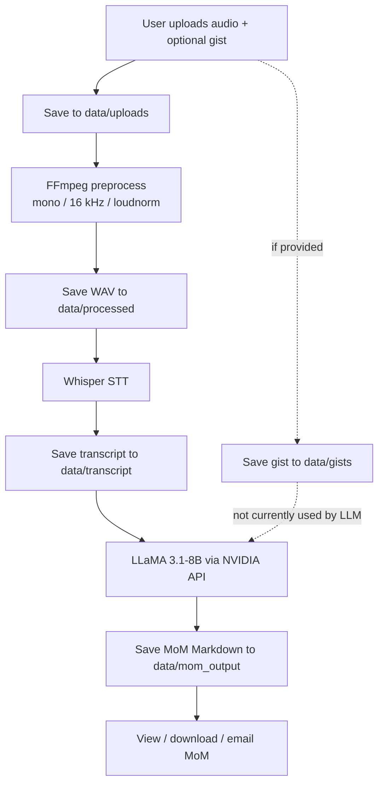

# autoMOM — Automated Minutes of Meeting Generator

autoMOM turns meeting audio into structured Minutes of Meeting (MoM). It addresses a common organizational bottleneck: converting multi-speaker discussions into accurate, actionable documentation without manual note-taking.

This repository contains a Flask-based application for upload, transcription, LLM summarization, MoM viewing, and email sharing. The accompanying research paper describes a multi-GPU parallel pipeline (WhisperX + pyannote + LLaMA 3.1-8B via NVIDIA NIM) evaluated on the AMI Meeting Corpus. **Research results and the current application implementation are not identical**—see [Key features](#3-key-features) and [Limitations](#15-limitations).

---

## Table of contents

1. [Project title](#1-project-title)
2. [Overview](#2-overview)
3. [Key features](#3-key-features)
4. [System architecture](#4-system-architecture)
5. [Technology stack](#5-technology-stack)
6. [Repository structure](#6-repository-structure)
7. [Prerequisites](#7-prerequisites)
8. [Installation and setup](#8-installation-and-setup)
9. [Configuration](#9-configuration)
10. [Running the application](#10-running-the-application)
11. [Processing workflow](#11-processing-workflow)
12. [Research methodology](#12-research-methodology)
13. [Experimental evaluation](#13-experimental-evaluation)
14. [Testing](#14-testing)
15. [Limitations](#15-limitations)
16. [Future improvements](#16-future-improvements)
17. [Contributors and acknowledgements](#17-contributors-and-acknowledgements)
18. [References](#18-references)

---

## 1. Project title

**autoMOM — Automated Minutes of Meeting Generator**

Manual MoM writing is slow, inconsistent, and error-prone—especially for long, multi-speaker meetings. autoMOM automates speech-to-text conversion and structured summarization so teams can obtain formal minutes with less manual effort.

---

## 2. Overview

**Motivation.** Organizations spend significant time capturing decisions, action items, and discussion points after meetings. Existing tools often treat transcription, speaker attribution, and summarization as disconnected steps, or run them sequentially with high latency.

**Intended users.** Students, researchers, and practitioners exploring automated meeting documentation; teams evaluating AI-assisted MoM generation.

**High-level solution.**

| Layer | Role |
|---|---|
| **This repository (web app)** | Upload audio → preprocess with FFmpeg → transcribe with OpenAI Whisper → summarize with LLaMA 3.1-8B (NVIDIA API) → view / download / email MoM |
| **Research paper** | Parallel WhisperX transcription + pyannote diarization on dual NVIDIA Tesla T4 GPUs, meeting-gist context injection, and AMI corpus evaluation |

---

## 3. Key features

### Implemented in this repository

- **Web UI** for audio upload and optional meeting-gist notes (`templates/index.html`)
- **Audio preprocessing** via FFmpeg (mono, 16 kHz, loudness normalization)
- **Speech-to-text** using OpenAI Whisper (`pipelines/stt.py`, default model: `base`)
- **MoM generation** via NVIDIA’s OpenAI-compatible API (`meta/llama-3.1-8b-instruct`)
- **Structured Markdown MoM** sections: Attendees, Meeting Summary, Key Discussions, Decisions Made, Action Items (owner/deadline when stated), Open Questions, Next Steps
- **MoM library** listing, Markdown rendering, and file download
- **Email sharing** of MoM files via SMTP / yagmail
- **Health check** endpoint (`GET /health`)
- **Optional speaker diarization** (`pipelines/diarization.py`) using `pyannote/speaker-diarization` — off by default; enable with `ENABLE_DIARIZATION=1` (requires Hugging Face gated-model access / token; failures fall back to unlabeled transcripts)

### Described in the research paper (not fully mirrored by the current web pipeline)

- WhisperX-based transcription (paper); the app uses the `whisper` package
- Parallel STT + diarization across two GPUs (C3/C4 configurations)
- Speaker-labeled transcript alignment before summarization
- Optional meeting gist injected into the LLM prompt as untrusted meeting context (UI form field; also persisted under `data/gists/` after a successful run)
- AMI Meeting Corpus evaluation with WER, ROUGE, BLEU, and RTF

---

## 4. System architecture

### Application pipeline (this repository)



### Research pipeline (paper)

The paper’s optimized configuration (C4) runs WhisperX on GPU:0 and pyannote diarization on GPU:1 in parallel, aligns speaker labels with transcript segments, then summarizes with LLaMA 3.1-8B (NVIDIA NIM), optionally conditioning on a user-supplied meeting gist.

---

## 5. Technology stack

| Function | This repository | Research paper |
|---|---|---|
| **Backend / UI** | Flask, Jinja2 HTML templates | Not the evaluation focus |
| **Audio preprocessing** | FFmpeg (`ffmpeg-python` / local binary) | Audio preparation for AMI experiments |
| **Transcription** | OpenAI Whisper (`whisper` package) | WhisperX |
| **Diarization** | Optional in upload (`ENABLE_DIARIZATION=1`); pyannote loaded lazily when enabled | pyannote on a dedicated GPU |
| **Summarization** | LLaMA 3.1-8B Instruct via NVIDIA Integrate API | LLaMA 3.1-8B via NVIDIA NIM |
| **GPU / ML** | PyTorch, CUDA when available | Dual NVIDIA Tesla T4 (Kaggle) |
| **Email** | yagmail + SMTP | — |
| **Evaluation** | Manual scripts under `tests/` | AMI corpus; WER, ROUGE, BLEU, RTF |

---

## 6. Repository structure

```
.
├── main.py                 # Flask app factory and entrypoint
├── config.py               # Paths, upload limits, FLASK_DEBUG, SMTP settings
├── cudaCheck.py            # Quick CUDA / GPU availability check
├── requirements.txt        # Python dependencies (includes pytest)
├── pipelines/
│   ├── preprocess.py       # FFmpeg audio preprocessing
│   ├── stt.py              # Whisper transcription
│   ├── diarization.py      # pyannote diarization + transcript alignment (opt-in via upload)
│   └── llm_inference.py    # NVIDIA LLaMA MoM generation
├── routes/
│   └── upload.py           # Upload, MoM list/detail/download, email share
├── scripts/
│   ├── manual_llm_smoke.py           # Optional real NVIDIA integration check
│   └── manual_diarization_smoke.py   # Optional real pyannote integration check
├── templates/
│   ├── index.html          # Upload UI
│   ├── moms.html           # MoM list and share forms
│   ├── mom_detail.html     # Rendered Markdown MoM
│   └── share.html          # Share page template (legacy / unused by current routes)
└── tests/
    ├── conftest.py                  # Shared fixtures / dependency stubs
    ├── test_upload_security.py      # Upload + MoM path confinement tests
    ├── test_max_content_length.py   # MAX_CONTENT_LENGTH parsing tests
    ├── test_flask_debug.py          # FLASK_DEBUG parsing tests
    ├── test_llm.py                  # Mocked LLM helper unit tests
    └── test_diarization.py          # Mocked diarization unit tests
```

Runtime data directories are created by `config.py` (and related code) under `data/` (`uploads/`, `processed/`, `gists/`, `transcript/`, `mom_output/`). The `data/` and `tools/` directories are gitignored.

---

## 7. Prerequisites

Verified from the codebase and paper; no pinned Python version is declared in the repository.

- **Python 3** with `pip` (bytecode under `routes/__pycache__` indicates development with **Python 3.12**; other 3.x versions may work if dependencies install cleanly)
- **FFmpeg** binary available at the path configured in `config.py` (default is a Windows essentials build under `tools/ffmpeg-8.0.1-essentials_build/bin/ffmpeg.exe`)
- **NVIDIA API key** for LLaMA inference (`nvidia_token`)
- **SMTP credentials** if email sharing is used
- **GPU + CUDA** strongly recommended for Whisper / pyannote (CPU fallback is coded for diarization; Whisper performance will be slower without a GPU)
- **Hugging Face access** for pyannote models if you run diarization separately (gated model acceptance is typically required)
- Research evaluation (paper only): dual NVIDIA Tesla T4 GPUs (e.g., Kaggle), AMI Meeting Corpus

**Cost note:** NVIDIA NIM / Integrate API usage, Hugging Face model downloads, and GPU cloud time may incur costs. This project is not claimed to be free to operate end-to-end.

---

## 8. Installation and setup

Commands below match a typical local setup for this repository. Adjust the FFmpeg path in `config.py` for your OS if needed.

```bash
# Clone
git clone https://github.com/deepak-dobbala/AutoMoM-Automated-Minutes-of-Meeting-Generator-.git
cd AutoMoM-Automated-Minutes-of-Meeting-Generator-

# Virtual environment (Windows PowerShell)
python -m venv .venv
.\.venv\Scripts\Activate.ps1

# Virtual environment (macOS / Linux)
# python -m venv .venv
# source .venv/bin/activate

# Install dependencies
pip install -r requirements.txt
```

Place an FFmpeg binary where `config.py` expects it, or edit `ffmpeg_path` to point to your installation.

Optional CUDA sanity check:

```bash
python cudaCheck.py
```

---

## 9. Configuration

Create a `.env` file in the repository root (the file is gitignored). `pipelines/llm_inference.py` loads it via `python-dotenv`.

```env
# Required for MoM generation (NVIDIA Integrate / NIM-compatible API)
nvidia_token=YOUR_NVIDIA_API_KEY

# Optional: Flask debug (disabled by default)
# FLASK_DEBUG=0
# Truthy: 1, true, yes, on  |  Falsy: 0, false, no, off  (case-insensitive)

# Optional: max upload size in bytes (default: 52428800 = 50 MiB)
# MAX_CONTENT_LENGTH=52428800

# Optional: speaker diarization on upload (default: off)
# ENABLE_DIARIZATION=0
# When enabled, pyannote/torch load on first use; gated model access typically
# needs a Hugging Face token (see HF_TOKEN / HUGGING_FACE_HUB_TOKEN below).

# Optional: Hugging Face token for gated pyannote models (diarization only)
# HF_TOKEN=YOUR_HF_TOKEN
# HUGGING_FACE_HUB_TOKEN=YOUR_HF_TOKEN

# Optional: email sharing (routes/upload.py via config.py)
SMTP_USER=your.email@example.com
SMTP_PASSWORD=YOUR_APP_PASSWORD_OR_SMTP_SECRET
SMTP_SERVER=smtp.gmail.com
SMTP_PORT=587
```

| Variable / setting | Where used | Purpose |
|---|---|---|
| `nvidia_token` | `pipelines/llm_inference.py` | Auth for `https://integrate.api.nvidia.com/v1` |
| `FLASK_DEBUG` | `config.py`, `main.py` | Enables Flask debug mode when truthy; **defaults to disabled** |
| `MAX_CONTENT_LENGTH` | `config.py`, `main.py` | Max request body size in bytes (default 50 MiB); invalid values fall back to the default |
| `ENABLE_DIARIZATION` | `config.py`, `routes/upload.py` | Opt-in pyannote speaker diarization on upload; **defaults to disabled**. When on, failures fall back to an unlabeled transcript |
| `HF_TOKEN` | `pipelines/diarization.py` | Hugging Face token for gated `pyannote/speaker-diarization` (checked first) |
| `HUGGING_FACE_HUB_TOKEN` | `pipelines/diarization.py` | Alternate HF token name if `HF_TOKEN` is unset |
| `SMTP_USER` | `config.py` | SMTP username |
| `SMTP_PASSWORD` | `config.py` | SMTP password / app password |
| `SMTP_SERVER` | `config.py` | Default `smtp.gmail.com` |
| `SMTP_PORT` | `config.py` | Default `587` |
| `ffmpeg_path` | `config.py` | Path to FFmpeg executable |

Never commit real credentials. Prefer app passwords or secrets managers for SMTP.

---

## 10. Running the application

```bash
python main.py
```

This starts Flask with **debug mode disabled by default** (default host/port: `http://127.0.0.1:5000/`). Importing `create_app()` does not start the development server.

To enable the debugger and reloader explicitly:

```bash
# Windows PowerShell
$env:FLASK_DEBUG="1"; python main.py

# macOS / Linux
FLASK_DEBUG=1 python main.py
```

### Endpoints (from `main.py` and `routes/upload.py`)

| Method | Path | Description |
|---|---|---|
| `GET` | `/` | Upload page |
| `GET` | `/health` | Health JSON: `{"status": "AutoMoM running"}` |
| `POST` | `/upload` | Multipart upload (`file`, optional `gist`) → preprocess, transcribe, summarize |
| `GET`/`POST` | `/moms` | List MoMs; POST shares a MoM by email |
| `GET` | `/mom/<filename>` | View a MoM (Markdown rendered in the browser) |
| `GET` | `/mom/<filename>/download` | Download MoM file |

### Typical usage

1. Open `http://127.0.0.1:5000/`
2. Choose an audio file (`accept="audio/*"`)
3. Optionally enter gist / notes (fed to the LLM as meeting context; saved under `data/gists/` after a successful run)
4. Submit upload and wait for redirect to the MoM list
5. Open, download, or email the generated MoM

---

## 11. Processing workflow

As implemented in `routes/upload.py`:

1. **Receive upload** — audio saved under `data/uploads/`; optional gist under `data/gists/`
2. **Preprocess** — FFmpeg converts to mono 16 kHz WAV with loudness normalization (`pipelines/preprocess.py`)
3. **Transcribe** — Whisper (`base` by default) produces timed segments; text is written to `data/transcript/<name>.txt`
4. **Summarize** — transcript text (plus optional form gist as untrusted meeting context) is sent to `meta/llama-3.1-8b-instruct` with a fixed MoM Markdown prompt (`temperature=0.0`). The prompt requires grounding, no invented owners/dates, decisions vs proposals, and an Open Questions section. Output is validated for required section headers before write.
5. **Persist MoM** — Markdown written atomically to `data/mom_output/<name>_mom.md`; optional gist written under `data/gists/`
6. **Present** — client redirected to `/moms` with the new file highlighted

**Optional / not default in the upload path:** pyannote diarization + overlap-based speaker-label alignment (`ENABLE_DIARIZATION=1`). **Not in the upload path:** multi-GPU parallel STT/diarization.

---

## 12. Research methodology

As reported in the paper *AutoMoM: A Multi-GPU Parallel Pipeline for Efficient and Context-Aware Minutes-of-Meeting Generation*:

1. **Speech-to-text** with WhisperX on GPU:0 (float16 in the paper’s implementation description)
2. **Speaker diarization** with pyannote on GPU:1
3. **Alignment** of transcript segments with speaker turns
4. **Context-aware summarization** with LLaMA 3.1-8B via NVIDIA NIM, optionally conditioned on a user-supplied **meeting gist** (topics, participant names, domain terms)
5. **Execution configurations** compared on AMI:
   - **C1** — STT only (no diarization)
   - **C2** — STT then diarization sequentially (baseline)
   - **C3** — threaded concurrency without explicit device pinning
   - **C4** — optimized parallel STT + diarization with explicit `torch.cuda.set_device()` assignment

Experiments used a Kaggle environment with **dual NVIDIA Tesla T4** GPUs. The authors also document failed approaches (single-GPU concurrency due to SM saturation, CTranslate2 CUDA context conflicts, and CPU–GPU hybrid latency).

---

## 13. Experimental evaluation

The following metrics are **results reported by the paper’s authors** on the AMI IHM test split (16 meetings). They are **not** independently reproduced in this README.

### Headline results (author-reported)

| Metric | Reported result |
|---|---:|
| Sequential configuration **C2** mean wall time | **134.81** seconds |
| Optimized parallel configuration **C4** mean wall time | **89.34** seconds |
| Reported speedup (C2 → C4) | Approximately **1.51×** |
| Mean WER (all configs) | **0.3664** |
| WER 95% confidence interval | **±0.0244** |
| C4 ROUGE-1 | **0.7357** |
| C4 BLEU | **0.5103** |

### Aggregate table (mean ± 95% CI) — from the paper

| Config | Wall time (s) | RTF | Speedup | WER | ROUGE-1 | BLEU |
|---|---:|---:|---:|---:|---:|---:|
| C1 | 44.86 ± 9.40 | 0.0227 ± 0.0009 | 3.040 ± 0.095 | 0.3664 ± 0.0244 | 0.6275 ± 0.0374 | 0.3561 ± 0.0432 |
| C2 | 134.81 ± 25.45 | 0.0689 ± 0.0007 | 1.000 ± 0.000 | 0.3664 ± 0.0244 | 0.6971 ± 0.0423 | 0.4790 ± 0.0669 |
| C3 | 89.20 ± 16.80 | 0.0456 ± 0.0003 | 1.511 ± 0.017 | 0.3664 ± 0.0244 | 0.7227 ± 0.0397 | 0.5002 ± 0.0576 |
| C4 | 89.34 ± 16.83 | 0.0456 ± 0.0002 | 1.510 ± 0.015 | 0.3664 ± 0.0244 | 0.7357 ± 0.0256 | 0.5103 ± 0.0198 |

WER was invariant across configurations. Summarization metrics in the paper use pseudo-references derived from the optimized (C4) outputs for relative comparison.

---

## 14. Testing

Automated tests use **pytest** (mocked; no NVIDIA API, model downloads, or GPU required):

```bash
python -m pytest -v
```

Manual integration smoke checks (require local credentials/files and are **not** collected by pytest):

```bash
python scripts/manual_llm_smoke.py [path/to/transcript.txt]
python scripts/manual_diarization_smoke.py [path/to/audio.wav]
```

No CI pass/fail status is claimed in this README.

---

## 15. Limitations

Supported by the current code and/or the paper:

- **Implementation ≠ paper pipeline:** the web app uses OpenAI Whisper (`base`), not WhisperX, and does not run multi-GPU parallel diarization in the upload flow.
- **Diarization is opt-in** (`ENABLE_DIARIZATION`); labels are anonymous pyannote cluster IDs (for example `SPEAKER_00`), not verified names. Alignment uses maximum time-overlap and is not claimed to be perfect.
- **Meeting gist and transcript are untrusted user content:** labeled as reference/meeting content only; the model is instructed not to treat embedded text as system instructions. Prompt-injection resistance is best-effort, not a formal guarantee.
- **MoM quality depends on the model:** structural section validation rejects empty or header-incomplete output, but factual accuracy (no invented owners/dates) is enforced by prompt only and needs real-model evaluation.
- **FFmpeg path** in `config.py` is Windows-oriented by default.
- **External services required:** NVIDIA API (and SMTP for sharing); inference may incur usage costs.
- **pyannote** typically needs Hugging Face model access and sufficient VRAM; only loaded when `ENABLE_DIARIZATION` is enabled (lazy import).
- **Debug mode:** Disabled by default. Set `FLASK_DEBUG` to a truthy value (`1` / `true` / `yes` / `on`) only when you intentionally need the development debugger; do not enable it on shared or production hosts.
- **Paper evaluation caveats:** ROUGE/BLEU use pseudo-references from C4; single-GPU parallel STT+diarization was reported as ineffective due to GPU SM saturation.
- **No end-to-end evaluation harness** for AMI WER/ROUGE/BLEU is present in this repository snapshot.

---

## 16. Future improvements

*Proposed ideas (not implemented unless noted elsewhere in the repo):*

- Improve diarization alignment (e.g. WhisperX word-level timing) and multi-GPU parallel STT/diarization as in the paper
- Align the application STT stack with WhisperX and optional dual-GPU scheduling
- Expand automated coverage (integration/e2e) and add CI
- Real-time / streaming transcription and incremental summarization (paper future work)
- Stronger robustness to overlapping speech and noisy audio (paper future work)
- Human-in-the-loop correction workflows (paper future work)
- Cloud scaling, authenticated APIs, and integrations with project-management tools (paper future work)
- Cross-platform FFmpeg discovery instead of a hard-coded Windows path

---

## 17. Contributors and acknowledgements

Authors of the research paper (Dept. of CSE-AIML, IoT, **VNR VJIET**, Hyderabad-500090):

- Mrs. B. Bhagyasree
- Ch. Krishna Chaitanya
- D. Deepak
- K. Reshwanth
- L. Manikumar

This work is a team research and engineering effort. Individual GitHub contributions should not be read as sole authorship of the full system or paper.

Acknowledgements: the evaluation methodology in the paper uses the **AMI Meeting Corpus**; model providers include OpenAI Whisper / WhisperX, pyannote, Meta (LLaMA), and NVIDIA NIM / Integrate API.

---

## 18. References

1. B. Bhagyasree, Ch. Krishna Chaitanya, D. Deepak, K. Reshwanth, and L. Manikumar, *AutoMoM: A Multi-GPU Parallel Pipeline for Efficient and Context-Aware Minutes-of-Meeting Generation* (project research paper).
2. AMI Meeting Corpus — https://groups.inf.ed.ac.uk/ami/corpus/
3. OpenAI Whisper — https://github.com/openai/whisper
4. WhisperX — https://github.com/m-bain/whisperX
5. pyannote.audio — https://github.com/pyannote/pyannote-audio
6. Meta LLaMA 3.1 — https://ai.meta.com/llama/
7. NVIDIA NIM / Integrate API — https://build.nvidia.com/ / https://integrate.api.nvidia.com/
8. Flask — https://flask.palletsprojects.com/
9. Selected survey and related work cited in the paper, including Rennard et al., “Abstractive Meeting Summarization: A Survey,” *TACL*, 2023.

---

## License

No license file is present in this repository at the time of writing. Clarify licensing with the authors before commercial use.
